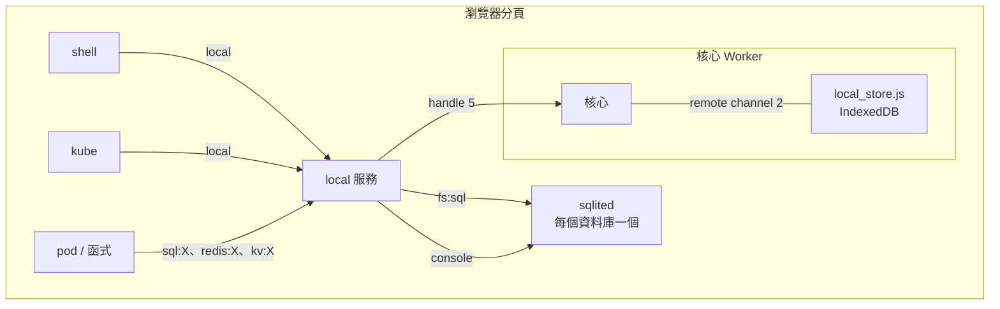

# 資料放在哪裡：前端或後端，程式不用改

狀態：完成（2026-11-01）。

## 問題

v2.0 的網站範例把資料放在後端（ruos serve 的 SQLite、Redis、kube 的 KV）。可是有些資料比較適合留在使用者自己的瀏覽器：單機的練習、快取、離線也能用的資料。我們想要：

1. 前端也有 SQLite、Redis 式的快取、KV。
2. **同一個程式**，資料放前端或後端只是部署時的選擇，程式碼一行都不用改。

## 為什麼做得到：capability

程式從來不知道資料在哪裡。它的名稱空間裡有一個叫 `sql:app` 的 handle，往裡面送 SQL、收 JSON。另一端是誰，由**給它這個 handle 的人**決定：

```mermaid
flowchart LR
  P[程式<br/>Sql::get&#40;"app"&#41;] -->|sql:app| X{另一端是誰？}
  X -->|sql:app| S[store] -->|WebSocket| B[ruos serve<br/>SQLite / PostgreSQL]
  X -->|sql:app@local| L[local 服務] --> Q[sqlited<br/>WASI 的 SQLite] --> I[(瀏覽器的<br/>IndexedDB)]
```

所以「可以選」只要在**給的時候**選：

| 寫法 | 程式看到的名字 | 資料在 |
|---|---|---|
| `uses = ["sql:app"]` | `sql:app` | 後端（`STORE/sql/app.db`，或 `--sql app=postgres://…`） |
| `uses = ["sql:app@local"]` | `sql:app` | 這台機器的瀏覽器 |
| `uses = ["redis:cache"]` | `redis:cache` | 後端的 Redis（`--redis cache=redis://…`） |
| `uses = ["redis:cache@local"]` | `redis:cache` | 瀏覽器（ruos 自己的小 Redis） |
| `uses = ["kv:notes"]` | `kv:notes` | 後端（kube 的叢集記錄） |
| `uses = ["kv:notes@local"]` | `kv:notes` | 瀏覽器 |

shell 也一樣：`sql -d app@local`、`redis -d cache@local`、`kv get notes@local KEY`、`run snoop console sql:app@local`。

## 架構



### 1. 瀏覽器的儲存：核心的 remote channel 2

核心本來就有「另一端在 host」的 channel（remote channel）：0 是 server 連線、1 是對外入口。第 2 條接到 host 的 `web/local_store.js`：一個很笨的「key → bytes」儲存，請求一次一個：

| 請求 | 回覆 |
|---|---|
| `[GET, key]` | `[OK, bytes]` / `[NOT_FOUND]` |
| `[PUT, key, bytes]` | `[OK]` |
| `[DELETE, key]` | `[OK]` |
| `[LIST, prefix, after]` | `[OK, 一行一個 key]`（一頁；從最後一個再問，直到空的） |

瀏覽器用 IndexedDB（資料庫 `ruos-local-MACHINE`；Worker 裡沒有 localStorage，而且 localStorage 只能存字串、約 5 MB、是同步的），Node 測試用檔案（`build/local/MACHINE/`，檔名是 key 的 hex）。IndexedDB 是非同步的，剛好合用：remote channel 本來就是「送出去、之後回來」。

核心把它交給 init 當 handle 5（只有在有 server 連線時：init 依順序分辨 3、4、5）。

### 2. `local` 服務

`services/local`，init 啟動它，給 shell 與 kube 各一個 client（`libsys::local::Local`）。請求是文字：`connect KIND:NAME` + 一條 channel 的一端 → `ok`，之後那條 channel 就說那種協定；`dup` 再給一個 client；`ls` 列出存了什麼。

它在「key → bytes」上面做出四種東西，**協定都和後端的一模一樣**：

| KIND | 協定 | 怎麼存 |
|---|---|---|
| `fs:ROOT` | `libsys::fs`（和 overlay 相同） | `m ROOT PATH` → `file SIZE` / `dir`；`c ROOT N PATH` → 第 N 個 32 KiB 區塊（`files.rs`） |
| `kv:NAME` | `libsys::kv`（和 kube 相同） | `k NAME HEX(key)` → 值（`kv.rs`） |
| `redis:NAME` | store 的 `REDIS` 請求（和 ruos serve 相同） | 在記憶體；每次修改後整份寫進 `cache` 樹的 `/NAME`（`cache.rs`） |
| `sql:NAME` | store 的 `SQL` 請求（和 ruos serve 相同） | `sqlited` 程式，檔案是 `sql` 樹的 `/NAME.db`（`sql.rs`） |

一條 channel 只能用它自己的那個名字（`sql:app` 的 channel 問 `sql:other` 會被拒絕），和後端的 grant 一樣。

### 3. 前端的 SQLite：`sqlited`（WASI）

SQLite 是 C 寫的。官方給瀏覽器的 `sqlite3.wasm` 是 Emscripten 版，要它自己的 JavaScript 才能跑，不是 WASI 程式。所以我們用 **wasi-sdk** 把 SQLite 編成 `wasm32-wasip1`：`wasi-programs/sqlited` 是一個 Rust 程式（`rusqlite`，`bundled`：把 SQLite 的 C 原始碼一起編），用 wasi-sdk 的 clang 編 C 的部分，連結 wasi-libc 模擬的 mmap / getpid / signal / clock。

它是一個普通的 WASI 程式：stdin 一行一個請求（JSON），stdout 一行一個回答，資料庫是目前目錄的 `NAME.db`。`local` 服務啟動它時：

- 它的 **console** 是 `local` 自己服務的：有請求時才回它的 READ_LINE，它 WRITE 的那一行就是回答。
- 它的 **fs**（WASI 的 preopen `.`）是 `local` 的 `fs:sql`：SQLite 的讀寫（`pread`/`pwrite`/`ftruncate`）經 WASI 轉接層變成 fs 協定的 `READ_AT`/`WRITE_AT`/`TRUNCATE`，最後是 IndexedDB 裡的區塊。
- 沒有檔案鎖（WASI 沒有）：用 `unix-none` VFS，因為只有 `local` 一個使用者。

所以這一步也證明了第 4 步的 WASI 層：一個沒改過的 C 函式庫，在 ruos 裡讀寫檔案。

另外，SQLite **官方的命令列 shell**（amalgamation 的 `shell.c` + `sqlite3.c`，只加一個回傳失敗的 `system()`：WASI 沒有行程）也用 wasi-sdk 編成映像 `sqlite3`：在 ruos 的 shell 裡打 `sqlite3 music.db "SELECT …"`，或不給 SQL 進入互動模式。它的檔案就是 shell 的目前目錄（和其他 WASI 程式一樣），所以資料庫檔案在 pod 的可寫層（後端）；`sql:NAME@local` 的才在瀏覽器。

`local` 是事件驅動的：等 sqlited 回答時，它照樣服務 sqlited 自己的檔案請求（不然會互相等待）。每個資料庫一個 sqlited，第一次用時啟動；它結束了（例如 trap），等待中的請求得到錯誤，下一個請求再啟動一個新的。sqlited 的映像只放在 registry（1.1 MB），第一次用時拉。

### 4. ruos 自己的小 Redis

瀏覽器裡沒有 Redis，所以 `cache.rs` 是一個很小的、相容的實作：字串（`GET` `SET [EX|PX|NX|XX]` `INCR` `APPEND` `MGET` …）、到期（`EXPIRE` `TTL` `PERSIST`，用牆上時鐘，重開機後也算數）、list、hash、set、`KEYS` `TYPE` `DBSIZE` `FLUSHDB`。回答的 JSON 與文字格式和後端相同（後端 Redis 的 RESP 值轉成 JSON 的方式）。不支援的指令回 `ERR unknown command`。

## 位置不同，語意不同

程式不用改，但**資料在哪裡會改變它的意思**，選的時候要想清楚：

| | `@local`（瀏覽器） | 後端（ruos serve） |
|---|---|---|
| 誰看得到 | 只有這個瀏覽器的這台機器（`?machine=NAME` 各自一份） | 所有機器、所有分頁 |
| kube 的 Function 換到別的節點 | 看到的是**那台**的資料 | 同一份 |
| 關掉瀏覽器、重開 | 還在（清除網站資料就沒了） | 在伺服器上 |
| 每次請求 | 不經網路 | 經 WebSocket 到 server |
| SQL 方言 | SQLite | SQLite 或 PostgreSQL |
| Redis | 常用指令的子集 | 真的 Redis |

所以給很多人用的網站（v2.0 的五個範例）放後端；單機練習、快取、離線資料放前端。測試裡同一個留言板程式部署兩次（`guestbook` 與 `uses = ["sql:guestbook@local"]` 的 `lguest`），兩邊的留言各自分開。

## 已知限制

- 沒有交易保證：fs 的區塊是一個一個寫進 IndexedDB 的，寫到一半關掉分頁，資料庫檔案可能不完整。
- `redis:NAME@local` 每次修改都整份寫回；大的快取會慢。
- sqlited 的記憶體（它自己的 linear memory）沒有記入 quota，和其他 WASI 程式一樣。
- 本機儲存只在有 server 連線時存在（init 依順序分辨 handle）。
